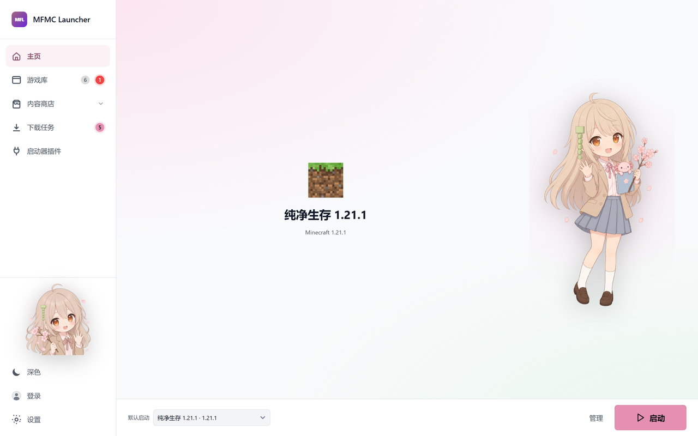
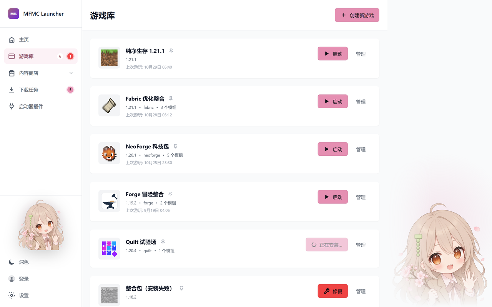
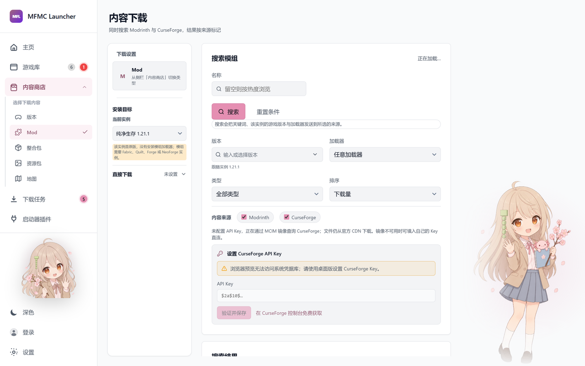
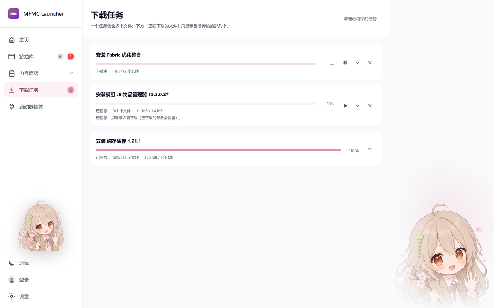

# MFMCL

A Minecraft: Java Edition launcher for Windows, macOS and Linux, written from scratch in Rust and
React. Chinese-first interface, isolated game instances, verified downloads, and a plugin system
that can actually install plugins.

> **Pre-release 0.1.0.** Builds are unsigned and not notarised. Expect rough edges, and expect your
> operating system to warn you the first time you run one. See [Status](#status) for what has and has
> not been verified.



Screenshots may show independently installed plugins; they are not part of the launcher download.

## Why another launcher

Most launchers solve "download the game and start it". The parts that are hard to get right come
after that: keeping 4,000 files intact, not corrupting a save when an install is interrupted,
telling you *why* the game crashed instead of dumping a log, and staying usable when the official
CDN is unreachable from where you live. MFMCL is built around those.

## What it does

### Instances, kept separate



Each instance gets its own directory, game folder, loader, mods and JVM settings. A broken or
half-installed instance cannot damage a working one. Cards show real state — installing, ready,
failed, never launched — rather than assuming success, and the last-launch time comes from the
database so "the one I played yesterday" is one click away.

### Verified downloads

Every game file is checked against the SHA-1 in Mojang's own manifest before it is moved into place.
Files are written to a temporary name, verified, then published atomically, so an interrupted
install leaves either the old file or the new one — never a truncated one. Downloads resume with
HTTP Range after a checksum-verified checkpoint, and a pause survives a restart of the launcher.

### Official, mirror, or both



Mojang's CDN is slow in a lot of places and sometimes unreachable. MFMCL can pull artifacts from
[BMCLAPI](https://bmclapi2.bangbang93.com/) instead, or try the mirror first and fall back — but
**the version manifest always comes from Mojang**, because it is what every other hash is checked
against. A mirror can make downloads faster; it cannot change what you get.

### Loaders and mods

Vanilla, Fabric, Quilt, Forge and NeoForge. Each loader type installs the way its authors intended:

- **Fabric / Quilt** publish a profile JSON that is merged with the vanilla profile at launch, so
  the official files stay untouched.
- **Forge / NeoForge** ship an installer JAR full of processors (mappings, jar splitting, binary
  patching). MFMCL runs them in order with the same verified-download and atomic-publish rules, and
  shows progress while they run, because a silent two-minute Java subprocess looks like a hang.

Mods come from a Modrinth and CurseForge search scoped to the instance's exact game version and
loader, installed only after the file's hash matches, and never overwriting a file you already have.
Update checks use Modrinth's hash lookup and keep the previous JAR as `.old`.

### Crash analysis, offline



A crash log is usually a stack trace wrapped in three layers of `RuntimeException` with `{re:mixin}`
smeared over every frame. Keyword matching reads that as "mixin failure" and sends you off disabling
mods, when the real cause is an inotify limit or a driver fault.

MFMCL analyses the exception chain instead: the innermost `Caused by` is the cause, the first
non-instrumented frame at the throw site is the culprit, and the instrumentation markers are treated
as noise. `hs_err_pid` files and watchdog timeouts get their own paths, since neither throws a Java
exception at all. Optionally, a small local model (LFM3-1.7B) explains the result in prose — it runs
on your machine, and the analysis works without it.

### Plugins that can actually be installed


Four ways to add a plugin, in increasing order of what they can do:

| Where it comes from | What it can contain |
| --- | --- |
| Built into the launcher | Only `launch-logger` and `download-mirror` |
| Pasted manifest | A description. No files, no script |
| `.mflp` / `.mfplugin` / `.zip` from disk | Files and artwork, optionally a `main.js` |
| A plugin source index over HTTPS | The same, fetched and hash-verified |

A package is a ZIP with `manifest.json` at the root. Before anything is extracted, the launcher
checks the archive for path traversal, absolute paths, Windows device names, control characters,
symlinks, duplicate entries, and decompression bombs. If the source index pins a SHA-256, the
downloaded bytes are verified against it first.

The launcher's plugin contract is **declarative**: a plugin can contribute JVM arguments,
environment variables, a pre-launch command, or a pre-launch backup — and the launcher validates
each one rather than executing whatever the plugin asks for. Aria with You is an optional,
independently installed seasonal artwork package, not a bundled plugin. Only `launch-logger`
and `download-mirror` are built in; Aria and all other non-built-in plugin bodies and assets
are excluded from the launcher repository and releases.

Installed packages live in `plugins/<id>/` under the application's data directory. Their artwork
is read through Tauri's scoped asset protocol. Retained host compatibility code does not preinstall
a plugin, and the launcher does not automatically load its artwork from `public/plugins/` or a CDN.

**There is no sandbox.** A package may contain a script, which runs inside the launcher's WebView
and can reach its IPC bridge. The archive defences stop malformed or malicious *archives*; they do
not contain a malicious *script*. The UI says so plainly, shows every permission a plugin requests,
and asks for confirmation after installing rather than quietly enabling it.

### Accounts

- **Offline profiles** for local play, clearly marked as unverified, with a fresh confirmation on
  every launch.
- **Microsoft accounts** via the browser with PKCE, plus a real entitlement check against the
  Minecraft services API. You supply your own application client ID —
  [`docs/MICROSOFT_LOGIN.md`](docs/MICROSOFT_LOGIN.md) explains why a launcher cannot ship one.
- **Yggdrasil skin servers**, HTTPS only, after you explicitly confirm the server root.

Credentials live in the operating system's credential store (Windows Credential Manager, macOS
Keychain, Secret Service on Linux). No password or token is written to the database, to the
frontend, or to a log.

### And the small things

- Four theme presets, custom accent colours, and a background image or video.
- Local, hash-checked backups with preview, restored into a *new* instance so a failed restore
  cannot destroy the save you were protecting.
- A command line that shares the same data directory, instances and accounts:
  `mfmcl download -v 1.21.1 --mod-loader neoforge latest --mod jei`. See
  [`docs/CLI.md`](docs/CLI.md).
- An optional seasonal theme, *Aria with You*, available only as a separately installed plugin
  package. It changes artwork and accent colour with the date and draws a different pose per page.

## Building

Requires Rust stable, Node 22+, and the Tauri prerequisites for your platform (WebView2 and MSVC on
Windows, Xcode command line tools on macOS, GTK 3 and WebKitGTK 4.1 on Linux).

```sh
npm ci --prefix design/flowlaunch-ui
npm run tauri -- build
```

For the browser preview without compiling Rust — which is how UI work is meant to start:

```sh
npm run dev          # then open http://127.0.0.1:5173/
```

[`docs/BUILDING.md`](docs/BUILDING.md) has the details, including a no-root Linux sysroot path and
the test suite. [`docs/ARCHITECTURE.md`](docs/ARCHITECTURE.md) explains the module boundaries and
where each trust decision lives.

## Status

Pre-release. The honest version:

**Verified.** A complete 1.21.1 install (3,984 files, 877 MiB), a Fabric instance, Modrinth mod
installs, a launch that reached the game's render thread, a backup create/preview/restore round
trip, and the plugin package pipeline end to end — all on Windows, against the real services.

**Not verified.** No signed or notarised build exists, so macOS and Windows will warn on first run.
Install/upgrade/uninstall has not been run on physical machines for all three platforms. The
Microsoft and Yggdrasil flows are covered by mock services in CI, not by a live account here.

**Not implemented.** OptiFine is explained in the interface but has no one-click install (there is no
official direct download, and it conflicts with Fabric-style class loaders). Modpack import covers
the Modrinth format for Vanilla/Fabric/Quilt; CurseForge packs, signed installers, and
self-replacement of the running binary are also absent (update checks and verified downloads work;
the swap waits for update signing). Application-store distribution is researched and deliberately
deferred — [`docs/FUTURE.md`](docs/FUTURE.md) records why.

Android, iOS and HarmonyOS are documentation only.

## Accounts and content

MFMCL does not bundle or host Minecraft game files. You need an account that is authorised for the
content you install. An offline profile does not verify Microsoft ownership and does not bypass
entitlement checks or online-mode server authentication.

## Licence and third parties

Third-party dependency constraints — aria2, Authlib-Injector, BMCLAPI, and the Minecraft content
policy — are documented in [`docs/THIRD_PARTY.md`](docs/THIRD_PARTY.md). No reference launcher's
code or assets are copied; observations are abstracted in
[`docs/REFERENCE_NOTES.md`](docs/REFERENCE_NOTES.md).
